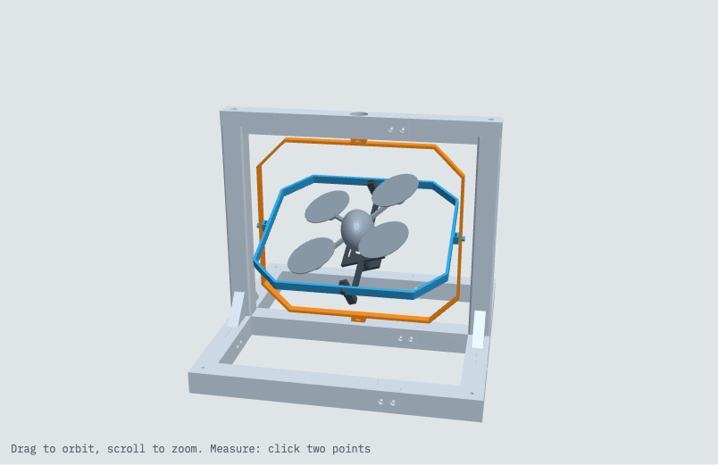

# Mini Drone Gimbal

A 3D-printable, three-axis test gimbal for a small egg-bodied quadcopter (about 140 mm across the prop tips). The drone sits in a cradle and can turn freely in yaw, pitch and roll, so you can test it and tune its flight controller without it flying away.



The whole design is generated in code with [manifold3d](https://github.com/elalish/manifold) from one Python script, `mini_drone_gimbal.py`. Every dimension is a named constant at the top of the file.


https://github.com/user-attachments/assets/53c70a79-8035-4576-9a55-f314e687e101


## How it works

- **Frame (yaw):** a portal frame, made of a base, two uprights and a top bar, holds a wide, flat octagonal **outer ring** on a vertical axis.
- **Outer ring (pitch):** holds a long, shallow **inner ring** on the axis across the portal.
- **Inner ring (roll):** holds the drone's **cradle** on the front-to-back axis.
- **Slip ring (v1.1+):** an SNM022A-12 slip ring at the top pivot lets wires pass down to the drone while the yaw axis turns without limit. From v1.2 the slip tube also runs in a 6702ZZ bearing.

Rig axes: X runs across the portal, Y runs front to back, Z points up, and the origin is the drone's centre of gravity.

Every pivot uses the same stack, from the turning part outwards:

```
boss -> 3.8 mm nub -> inner race of an MR63ZZ (pressed into the outer part)
     -> printed shim -> M3 x 8 socket head, through the boss into an M3 nut
```

The nub and the shim touch only the inner race, so the bearing turns freely.

## Usage

```bash
pip install numpy scipy manifold3d trimesh networkx lxml

python mini_drone_gimbal.py check   # sweep all three axes for collisions
python mini_drone_gimbal.py stl     # write stl/*.stl and 3mf/*.3mf
python mini_drone_gimbal.py html    # write preview.html from preview_template.html
python mini_drone_gimbal.py all     # all of the above (the default)
python mini_drone_gimbal.py v1.1    # check one version, write all its parts, BOM and a preview image to v1.1/
python mini_drone_gimbal.py versions  # the same for v1.0, v1.1 and v1.2
```

`preview.html` is a self-contained 3D viewer. Open it in a browser: drag to orbit, scroll to zoom, and click two points to measure the distance between them.

## Parts

All parts print without supports, in the orientation they are exported in, on a 256 mm bed. The rings print whole. The top bar and the base are cut into sections that overlap side by side and bolt together with M3 screws.

I printed the parts in PLA on a Bambu Lab A1.

| File | Notes |
|---|---|
| `base_a` … `base_d` | Base frame, in four corner sections |
| `upright` | Print **2** |
| `top_bar_a`, `top_bar_b` | Top bar, in two sections |
| `outer_ring` | Yaw ring |
| `inner_ring` | Pitch ring |
| `cradle` | Holds the drone, on the roll axis |
| `cover`, `clip` | Hold the drone's body down in the cradle |
| `sensor_mount` | Plate for a small sensor board under the tray |
| `slip_mount`, `slip_tube` | Slip ring mount at the top pivot |
| `pivot_shims` | 8 shims (6 needed, plus spares). Print with a brim |
| `bearing_fit_test` | Print this first to tune `BEARING_D` for your printer |

`stl/` and `3mf/` hold the current build (v1.2). `3mf/all_printings.3mf` is a combined print plate made in the slicer, not by the script.

Each version folder holds that version's complete set of parts, so you can print any version from its folder alone.

```
v1.0/  v1.1/  v1.2/
  stl/*_v1.x.stl          every part for that version
  3mf/*_v1.x.3mf          the same parts as 3MF
  BOM_v1.x.md, .csv       bill of materials: printed parts and hardware
  preview_v1.x.png        the assembled rig
```

v1.0 has no `slip_mount` or `slip_tube`. `v1.1/` and `v1.2/` also hold section views of the top pivot. The `mini_drone_gimbal_v1.x_stl.zip` files bundle each folder and aren't kept in git.

Between versions only the top pivot changes:

| Part | v1.0 → v1.1 | v1.1 → v1.2 |
|---|---|---|
| `outer_ring` | changed | same |
| `top_bar_a` | changed | same |
| `slip_mount`, `slip_tube` | new | `slip_mount` changed |
| everything else | same | same |

## Hardware

Each version's `BOM_v1.x.md` has the exact quantities. In short:

- MR63ZZ bearings (3 × 6 × 2.5 mm) for the gimbal pivots
- 6702ZZ bearing (15 × 21 × 4 mm) on the slip tube
- SNM022A-12 slip ring. The mount uses dimensions from its drawing, so check them against your part.
- M3 socket-head screws: M3 × 8 (pivots), M3 × 12 (frame), M3 × 16 (slip ring foot, sensor mount), M3 × 20 (lap joints)
- M3 nuts

## Versions

- **1.0:** first version. Top pivot on an MR63ZZ bearing.
- **1.1:** a slip ring replaces the top pivot bearing.
- **1.2:** the slip tube runs in a 6702ZZ bearing.

## Notes

- The drone's centre of gravity, prop height and some other drone dimensions are estimates. They are marked in the source, so adjust them for your drone.
- Printed holes usually come out undersized. The bearing hole diameters already include some extra allowance, and `bearing_fit_test` lets you tune them.

## Credits

The design work, from the generating script to the parts, checks and version builds, was done by [Claude Code](https://claude.com/claude-code). [webtrackerxy](https://github.com/webtrackerxy) refined the design and guided the work.
